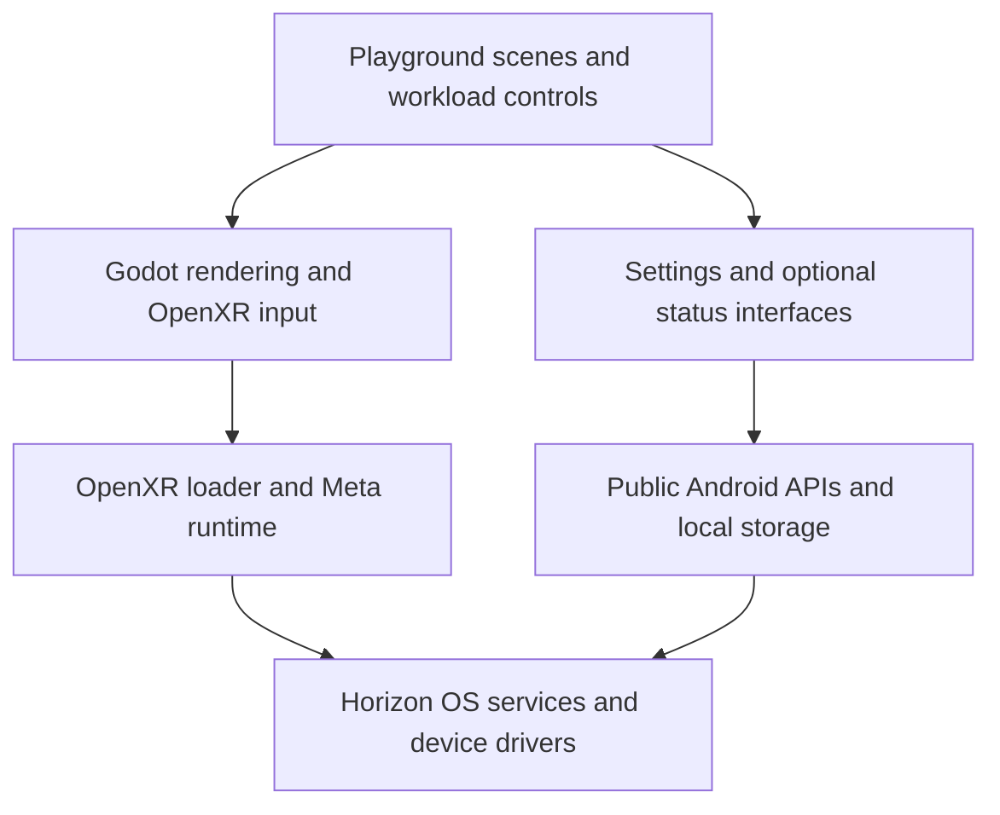

# QuestOS Technical Plan v0.4

**Date:** November 5, 2026  
**Audience:** Project owner and assisting development and review agents.  
**Target:** Personally owned 64 GB Meta Quest 2, reported stock; exact firmware and boot state pending inventory.  
**Supersedes:** v0.3 as the proposed project plan.

QuestOS is a hobby project to learn how to build lightweight VR software and investigate whether alternative system software can extend the Quest 2's usefulness. Its first deliverable is a small Godot/OpenXR performance playground running as an ordinary application on stock Horizon OS. A useful stock-OS application is a successful outcome independently of OS research.

The app path is feasible to investigate within the available time. Read-only and off-device research remain active alongside it. On-device privileged experiments are currently blocked: the exact device state, compatible method, and credible operation-specific recovery evidence are not established. The owner accepts residual risk only after the recovery requirement is met.

This revision updates the document only. Its future procedures are planning material, not authorization to create repositories, implement code, install tools, purchase services or hardware, reset the headset, or perform experiments. Later work must stay within the scope the owner actually authorizes.

## 1 Settled goals and constraints

| Decision | Agreed direction |
|---|---|
| Primary outcome | Learn to build small, responsive applications that keep the Quest 2 useful. |
| First prototype | A performance playground with repeatable workloads and understandable measurements. |
| Follow-up preference | A simple VR workspace, then potentially a small game or interactive toy. These are candidates, not simultaneous commitments. |
| OS research | An active, bounded parallel interest. Independent boot is an optional outcome. |
| Device history | Owner reports normal updates and installed apps only; no root, bootloader unlock, or system modifications. Moderate gaming use, with little use during the past one to two years. |
| Reported symptoms | Slower startup and system menus, plus occasional game stuttering. Updates were associated with the observations; causation is unverified. |
| Factory reset | Owner intends a fresh start after preserving relevant data and baseline observations. A reset is not evidence of boot-chain recovery. |
| Hardware risk | Credible recovery evidence is required for the complete privileged operation. Residual risk is acceptable after that gate; an unproven recovery route is not. |
| Proprietary components | Acceptable where useful and appropriately reusable. A fully open-source hardware stack is not required. |
| Human capacity | One human, approximately 2–4 flexible hours per week, mostly evenings and weekends. No calendar deadline. |
| Experience | Unity and Unreal experience; new to Godot, limited Android-emulator experience, no Linux-kernel or embedded-debugging experience. |
| Cost baseline | Existing subscriptions, tools, and hardware. No new recurring spending is planned. Justified purchases may be considered separately. |
| Repository | Public, using the project-manager project's intended human/bot ownership separation where suitable. Effective permissions remain to be verified. |

Subscriptions do not establish particular compute quotas, unlimited builds, or access to every cloud feature. Check actual capabilities during authorized setup. Reduce scope or build frequency before proposing purchases; identify the problem, cost, and simpler alternatives. Neither replacement hardware nor a paid signing or attestation service is a prerequisite for the first app.

## 2 Success and scope

### First headset proof

The first app milestone proves that one identified signed APK launches from the headset UI without a PC or network, renders a simple stationary scene, accepts controller input, and exits normally. Record the tested configuration, available telemetry, and provisional observations. Final numerical budgets, measurement calibration, and the complete lifecycle matrix are later acceptance work.

### Performance playground

The measured playground succeeds when the owner can operate its controls, compare a baseline with a small number of bounded workloads, understand what the measurements do and do not represent, return to baseline, and exit reliably. At least one validated execution-time, utilization, memory-use, or frame-delivery metric must show a repeatable response to a controlled workload change beyond observed variation. Changed preset labels, declared object counts, and actual draw/primitive counts establish workload delivery or accounting; they do not by themselves establish a measured performance response. This establishes a useful comparison instrument, not a general diagnosis of the headset.

If safe, available telemetry establishes only workload changes, retain the useful app and describe that narrower achievement. Do not mark the P2 performance-response criterion as passed, force an FPS drop, or automatically add native instrumentation merely to clear the milestone. A useful stock-OS app remains a successful outcome.

| Feature | Initial scope |
|---|---|
| Scene | One simple, stationary environment suitable for seated or standing use. |
| Interaction | Quest controllers, ray selection, and simple controls; no locomotion requirement. |
| Workloads | Start with baseline and one controlled geometry or material change. Add a small panel workload only after the first comparison works. Change one major variable at a time. |
| Measurements | Validated app timing and other available metrics, labeled by source and meaning. |
| Results | One compact run-record format referring to reusable device and toolchain profiles. Begin manually; add export only when it saves effort. |
| Escape | Baseline on every launch, an obvious return control, hard workload and duration caps, normal system-menu exit, and a rehearsed app removal/reinstallation path before retaining a release. |

The prototype does not promise to speed up stock startup, system menus, or unrelated games. Those symptoms belong to the observational baseline and research track.

Panel dragging, resizing, keyboard entry, themes, persistent layouts, module APIs, and a general desktop shell are deferred. Stage 1 excludes root, launcher replacement, arbitrary Android app windows, camera access, downloaded executable plugins, custom kernels, firmware changes, cloud AI features, and commercial-store release. Automatic escalation toward an unusable load and clock/thermal-control modifications are excluded.

## 3 Device baseline and the planned reset

The stock history is an owner report. Product identifiers, build fingerprint, incremental build, Android/security-patch versions, verified-boot indicators, slot information where exposed, and developer-mode state remain unknown. Record missing fields as unknown; do not infer them from purchase date or a marketing OS version. Collect only metadata needed for the current question.

Before reset, record the visible OS version and any exact build identity available through ordinary, authorized access, free storage, installed-software context, and the version of any game used for comparison. Capture a few repeats of startup to a defined usable screen, repeated menu interactions, and one familiar game scenario if practical. Record battery level, charging/network state, prior use, and broadly comparable room conditions. Keep this a short observational baseline, not a benchmarking project that indefinitely delays the planned reset.

Identify the local saves, captures, and other data the owner wants to preserve. For each important item, identify a usable restoration route rather than assuming a backup exists or covers it. Preserve the wanted data before reset; if a wanted item cannot be preserved, resolve that specific loss with the owner before proceeding. Confirm account access and the setup/controller requirements. Provisioning and restoration may need networking even though the eventual app should work offline.

Reset preparation and off-device preparation are separate tasks. A preservation issue can delay the reset without blocking separately authorized source review or isolated export preparation. Keep the owner's planned preservation, observation, reset, and provisioning sequence; off-device progress does not authorize changing that sequence or beginning headset testing.

Developer-mode and USB authorization are setup changes, distinct from subsequent read-only inventory. If obtaining exact pre-reset identity requires those changes, perform them only within authorized setup and record their timing, or leave the field unknown. Do not run root/unlock utilities or alter partitions, slots, updates, or firmware to obtain inventory. Keep raw output private; publish sanitized records without serial numbers or account identifiers.

After the owner performs the reset and provisioning, wait for known downloads/restoration work to settle before repeating observations. Repeat a small sample again during ordinary use. Record firmware, app-version, restored-data, and storage changes.

A before/after comparison remains observational even with unchanged firmware. Caches, installed software, free storage, background work, thermal conditions, and trial order can differ. Report an observed difference between the recorded configurations, not an isolated reset effect or proof that updates caused the original symptoms.

## 4 Application architecture and portability

Use a small Godot project with scenes, GDScript, OpenXR input, a workload controller, and a measurement recorder. Add narrow interfaces only for dependencies that actually exist, such as settings, optional device status, or result storage. Prefer explicit calls and Godot signals over a general event bus or service framework.

The rendering/input dependency and application-service dependency are separate:

Godot supports Android/OpenXR deployment, including Quest. Its Android XR guidance recommends Compatibility as a conservative starting renderer. From Godot 4.6, the Vendors plugin is optional but recommended; use it for needed vendor features rather than making all its capabilities prerequisites. Vendors v5 requires Godot 4.6 or newer. Select and record an exact engine, plugin if used, export-template, JDK, SDK, Gradle, ABI, and renderer combination for the first build, then retain the headset-tested combination. Official support does not prove this exact device configuration works. [Godot Android XR deployment](https://docs.godotengine.org/en/stable/tutorials/xr/deploying_to_android.html), [Vendors v5.1 announcement, May 19, 2026](https://godotengine.org/article/godot-xr-update-may-2026/).

GDScript is the initial default. C#, C++, Rust, and native services require a concrete need and export/maintenance assessment. Select a test framework when meaningful testable logic warrants it. Parsing/import and clean export can precede a framework.

OpenXR defines the application/runtime interface; it does not supply Quest drivers, tracking, calibration, composition, or a replacement OS. An independent OS needs a compatible engine, graphics stack, and functioning XR runtime as well as any service adapters. Vendor-component reuse also requires compatible ABIs, services, kernel interfaces, and maintenance arrangements. Runtime extensions require capability checks and appropriate fallbacks. [Khronos OpenXR specification, cited release 1.0.34](https://registry.khronos.org/OpenXR/specs/1.0-khr/html/xrspec.html).

A future desktop OpenXR build can test application portability; running through a desktop runtime does not establish standalone Quest boot, tracking, or driver compatibility. Build a module interface only after two concrete first-party views expose a useful common contract. Modules in one process share its privileges and are not sandboxed from one another.

## 5 Measurements and acceptance

### Metric validity

A metric may support acceptance only after its source/API, units, sampling cadence, aggregation, release-build availability, and meaning are verified on the selected configuration. Record these once in a small metric table and reference it from runs. An unavailable or unvalidated metric cannot be recorded as zero or used to pass a criterion.

| Quantity | Interpretation and limits |
|---|---|
| Engine callback intervals | Elapsed monotonic time between observations at the same callback point; includes pacing and scheduling effects. This does not establish CPU execution time, presented-frame timing, or motion-to-photon latency. |
| Engine processing-time monitors | Verify the measured scope and update/aggregation behavior for the pinned engine revision. A per-second maximum is not a raw per-frame series or automatically CPU execution time. |
| CPU execution and app GPU execution | Separate measurements from identified sources. CPU and GPU work can overlap; adding them is not a universal frame-cost calculation. |
| Application FPS | Identify its aggregation interval. A once-per-second FPS value cannot supply per-frame p95/p99 statistics. |
| Requested, predicted, and current refresh | Record separately. A request or runtime-predicted display period does not establish the hardware's current refresh rate. |
| Runtime frame-delivery counters | Preserve the source's exact definition, units, counter interval, and reset behavior. Stale frames, dropped frames, and missed deadlines are not interchangeable labels. |
| Workload counters | Declared object counts and actual rendered draw/primitive counts help verify the workload. A changed counter alone does not demonstrate execution cost, resource-use cost, frame-delivery impact, or headroom. |
| Memory | Identify the process/allocation scope and availability in release builds. System free memory alone cannot prove absence of an app leak. |
| Thermal and power indicators | Record available signals and conditions without changing clock or thermal policy. Battery temperature alone does not establish processor thermal equilibrium. |

Godot documents that some monitors return zero in release exports and that its FPS monitor updates once per second. Per-frame percentiles therefore require actual per-frame samples, not repeated polling of an aggregate value. Validate the recorder against a deliberately changed but bounded workload; retain enough samples or a defined histogram to reproduce the reported statistics. [Godot Performance API](https://docs.godotengine.org/en/stable/classes/class_performance.html).

The default callback-interval recorder uses differences between `Time.get_ticks_usec()` timestamps captured at the same defined callback point. Godot documents this clock as monotonic. Do not substitute system-clock time or simulation delta for elapsed time. `_process(delta)` can be capped or affected by delta smoothing, and in Godot's `4.6-stable` source, `TIME_PROCESS` is updated roughly once per second from the accumulated maximum process duration. Polling that monitor every frame does not create per-frame process-time samples. Keep aggregate monitors separately labeled and verify behavior again for the exact engine revision selected; this source observation does not establish all versions' behavior. [Godot Time API](https://docs.godotengine.org/en/stable/classes/class_time.html), [Node processing delta](https://docs.godotengine.org/en/stable/classes/class_node.html#class-node-private-method-process), [Godot `4.6-stable` timing publication](https://github.com/godotengine/godot/blob/4.6-stable/main/main.cpp#L4989).

Read current display refresh through a supported runtime interface or appropriate external tool when available. OpenXR allows the predicted display period to differ from the hardware refresh cycle; the refresh-rate extension is optional and must be supported/enabled before use. [OpenXR frame state](https://registry.khronos.org/OpenXR/specs/1.1/man/html/XrFrameState.html), [Current display refresh query](https://registry.khronos.org/OpenXR/specs/1.1/man/html/xrGetDisplayRefreshRateFB.html).

Meta's metrics distinguish app GPU time, current display refresh, stale frames, eye-buffer resolution, and foveation. Use the definitions appropriate to the tool and runtime actually tested. A tool described in documentation is a candidate source, not confirmed telemetry on this headset. [OVR Metrics definitions, updated October 2, 2026](https://developers.meta.com/vr/documentation/native/android/ts-ovrstats/).

### Compact run records

Each run references the exact signed APK digest and source revision, a toolchain profile, a sanitized device/firmware profile, and the metric definitions. Record preset parameters, actual render settings, requested/current refresh where available, instrumentation mode, warm-up/sample durations, power/network conditions, interruptions, and results. Identify the session and sample windows, distinguish calibration from acceptance data, and reference the applicable acceptance-rule revision. Reuse unchanged profiles rather than manually copying every field. Diagnostic runs with attached tools are distinguished from standalone acceptance runs.

### Initial comparison protocol

Start with one baseline A and one controlled workload B. Use the same signed APK where possible; source changes produce a new candidate and require fresh measurements.

1. Fix scene content/seed, render resolution, antialiasing, foveation, and other relevant settings. Disable app-controlled adaptive rendering for fixed-workload comparisons where supported, or record it and describe the result as an adaptive-system comparison. Keep normal head tracking enabled and use repeatable viewing instructions.
2. Record broadly comparable ambient conditions, prior use, battery range, charging and networking. Prefer a consistent unplugged condition. Record available thermal/throttling signals rather than forcing clocks or overriding thermal behavior.
3. Begin with approximately two minutes of fixed warm-up and three 60-second sample windows per condition. Alternate order, for example A–B, B–A, A–B, with the same settling interval after switches. These are initial project defaults, not a claim of thermal equilibrium or a platform requirement. Revise them if repeatability is poor.
4. Separate startup/loading and lifecycle interruptions from steady workload samples. Mark excluded periods and the reason; do not silently discard slow frames. If baseline performance drifts, report the drift and cool/repeat or narrow the conclusion.
5. Compare variation across repeated windows with the A/B difference using the recorded comparison rule. A change smaller than the observed variation is inconclusive. Keep each window's result; thousands of frames in one window do not substitute for repeated observations under comparable conditions.

Shorter single comparisons are useful for iteration but do not establish repeatability. Repeated windows in one session support within-session repeatability only. Claims about repeatability across sessions require separate-session evidence; this is not an extra P1 requirement. Cross-firmware or materially different-condition results remain observations, not isolated app-performance comparisons.

### Instrumentation overhead

Use the same APK to compare panel hidden/shown and logging disabled/enabled. Batch recording and update the display at a modest rate rather than adding avoidable work every frame. Where possible, use an independent runtime source to estimate recorder overhead; the recorder cannot establish its own disabled-state overhead by itself. If no independent source is available, label total overhead unquantified. Keep instrumentation modes consistent between comparisons and do not claim improvements below the observed measurement variability.

### Acceptance and device scenarios

P1 establishes available telemetry and provisional observations. During P2, use calibration observations to validate the instrument and establish provisional limits. Before collecting acceptance data, record owner-approved metrics, limits, exclusions, the comparison rule, and the per-repeat decision rule. Collect fresh acceptance windows after that freeze; calibration data cannot also serve as acceptance evidence. The same signed APK may be used for both stages. Evaluate 72 Hz if supported; approximately 13.9 ms is its display interval, not a verified application execution budget. Higher rates can wait.

The baseline acceptance record specifies sample duration, repeat count, the exact timing quantity, percentile limits, maximum-interval and over-limit-count criteria, available frame-delivery and memory criteria, and acceptable sustained degradation. Retain each window's selected percentiles, maximum interval, over-limit count and sample count. Evaluate individual windows under the frozen rule; pooled statistics must not hide a failed repeat. State how failed, interrupted, and excluded windows affect the result before collecting acceptance data. A callback-gap limit concerns callback timing and does not become a claim about display delivery.

Choose values from calibration measurements and the intended comfort requirement; do not invent universal thresholds or loosen them silently to accept a failing candidate. A changed metric, limit, exclusion, or decision rule requires a recorded rationale, owner approval, and fresh acceptance evidence for the affected criteria. Preserve the earlier observations and disposition rather than retrospectively relabeling them as passes.

If a desired metric is unavailable, mark that criterion unassessed and explicitly narrow the acceptance claim. At minimum, validate one timing measure and demonstrate a repeatable controlled response beyond observed variation in a validated execution-time, utilization, memory-use, or frame-delivery metric. Workload counters may corroborate the change but do not satisfy that response criterion alone. A missing GPU or memory metric need not block a useful limited playground, but cannot become a GPU-headroom or leak-free claim. If safe telemetry supports only workload accounting, retain the useful app without declaring P2 complete. Record unavailable evidence as unassessed and an observed but unresolved comparison as inconclusive; neither is a pass. Resolve the limitation only when worthwhile; do not increase load to discomfort, force an FPS drop, or automatically add native instrumentation.

Exploratory presets may intentionally miss baseline performance targets, but must have numeric load and duration caps defined before device use. Start every launch at baseline; do not restore a stress preset automatically. Timed runs return to baseline while the app remains responsive. An in-app timer/button cannot recover a completely hung process. Verify ordinary system-menu exit at the maximum permitted preset. Stop on discomfort, thermal warnings, or unrecoverable tracking/input problems; do not escalate load to test failure recovery.

For a retained release, test:

- Launch from the headset UI after reboot, with networking disabled and the PC disconnected. ADB-assisted launch does not satisfy this check.
- Open/close the system menu, lose/regain focus, and remove/re-wear the headset without stuck interactions.
- Recenter, lose tracking, or disconnect a controller; cancel active actions and keep controls recoverable.
- Pause/resume and sleep/wake without a broken session or unreachable panels.
- Switch presets repeatedly, return to baseline, and exit normally, including at the permitted maximum load.
- Identify the installed build and rehearse app removal/reinstallation, including any intended data preservation.

Use a short launch/input/exit smoke check for ordinary iterations, plus scenarios affected by the change. Run the complete matrix and one approximately 20–30 minute baseline soak on the first retained release; repeat relevant checks after material changes or regressions. Record sustained trends, comfort, and text legibility. Average FPS alone is insufficient.

Add persistence only when useful. Before retaining user data, define atomic writes, schema versioning, corrupt-settings recovery, and any needed export/import path. Test representative upgrades. A higher-version recovery APK can avoid some installation constraints but still must handle the data schema correctly.

Headless tests cover meaningful workload state, caps, recording calculations, and later persistence logic. Clean import/export and package inspection check buildability and packaging. None replaces physical XR or comfort assessment.

## 6 Workflow and repository controls

### Roles and owner workload

The proposed repository is `Johnson-Dev-Agent-Management/questos`, public, subject to availability and authorized setup. The project-manager model uses `codexcodemachine` for implementation PRs and leaves merges, releases, deployments, and purchases to the owner; its CODEOWNERS names `Joshbomb75`. Reuse this intended separation, not its web-specific toolchain or entire check suite. The documents do not certify actual access or enforcement. [Workflow snapshot](https://github.com/Johnson-Dev-Agent-Management/project-manager/blob/f0615f00af5fea9745578659c65d3ead5db75365/AGENTS.md), [CODEOWNERS](https://github.com/Johnson-Dev-Agent-Management/project-manager/blob/main/.github/CODEOWNERS).

Keep a short backlog, one active app change, and one bounded research question. Use independent agent review for substantive changes to execution, packaging, dependencies, measurement, or safeguards. Routine wording and trivial visual changes receive proportionate owner review and any affected smoke checks; they do not automatically need a separate agent review exercise. Give the reviewer the requirements, actual diff, validation changes, and raw results, not only the implementer's summary. Use a separate review context with read-only access to the selected source and evidence, and require it to identify the reviewed revision. The reviewer cannot alter the candidate, its checks, or release evidence as part of that review. The owner remains accountable for acceptance and merges. Agent reviewers can share mistaken assumptions and cannot substitute for device-specific expertise or recovery evidence. Neither a reviewer fleet nor a different-model requirement is needed.

Batch a small, coherent candidate for the owner's available session. Do not grow a review queue simply because agents can produce changes faster. Add orchestration or a persistent manager only after a demonstrated coordination problem.

### Effective access boundaries

Use an isolated development environment for implementation, builds, relevant tests, and draft PR preparation. Cloud hosting is preferred where existing capacity supports it, but is not a technical P1 success criterion. Any alternative must preserve the same credential, signing, release, and headset boundaries; a normal owner desktop session does not establish that isolation. Before agents receive write access, verify their effective identities and capabilities across shell credentials, GitHub connections, apps/MCP tools, browser sessions, environment administration, and any local execution tools exposed to the task. A bot username or restricted shell alone is insufficient.

Implementation agents must lack owner write credentials, release signing keys, release administration, privileged research access, and routes to the test station/headset. Configure these boundaries in the services and environments, not only in AGENTS.md. Check the configured identities/permissions and representative harmless access denials; this is a small setup check, not an exhaustive adversarial certification project. Recheck when access changes.

The owner's Windows PC is the physical test station. The owner performs authorized signing, installation, and hardware testing. Do not make it a CI runner for the public repository or expose remote shell, forwarded ADB, or VPN access to development agents. A local agent able to read the signing key would violate the boundary even if the cloud container were isolated.

Current Codex Cloud supports configurable VPN/network access; commands, connectors, and other execution surfaces require their own controls. Account-specific availability remains unknown. [Cloud environments](https://learn.chatgpt.com/docs/environments/cloud-environments), [Codex security boundaries](https://learn.chatgpt.com/docs/enterprise/security-cookbook).

Use a pinned setup recipe and clean builds. A cached workspace is not proof of reproducibility, and a clean workspace that remains interactively writable by an implementation agent does not establish the retained-release build handoff in section 7. When executable privileged research begins, keep its code/tools in a separate environment/repository; app builds must not consume them. Read-only notes can initially remain with the plan.

### Checks and review

Require PRs and human review, prevent agent bypass/direct protected-branch writes, and invalidate stale approvals when relevant code changes. Verify actual collaborators, team/app permissions, and enforced rules. Protect workflow, tests, fixtures, thresholds, exclusions, validators, dependency/lockfile, signing-policy, and CODEOWNERS changes through explicit owner review.

Begin with one clean export and package-inspection result for the first headset proof. Once repeatable, make that path a required CI check and add meaningful logic tests as the app grows. Do not require the project-manager repository's seven checks, repeated web E2E qualification, a generic coverage floor, or a test framework before the first scene.

Bind required statuses to the expected publisher, but also identify the workflow/validator revision that ran. A PR can weaken its own check while still receiving a green status from GitHub Actions. Treat affected results as provisional until changes to the check are reviewed. Retain a small owner-controlled release inspection procedure outside the candidate's control. These controls improve confidence; they do not prove arbitrary candidate code cannot deceive its tests. [GitHub rulesets](https://docs.github.com/en/repositories/configuring-branches-and-merges-in-your-repository/managing-rulesets/available-rules-for-rulesets).

Run untrusted builds without secrets or write-capable release credentials. Keep privileged jobs and caches isolated; do not execute PR code through privileged triggers. Pin actions/dependencies, review updates, and verify dependency/artifact provenance. Content scans are defense in depth, not proof of sandboxed behavior. Do not assume a generic scanner covers GDScript or every native library. Use modest CI concurrency/retention and retain known-good releases separately. [GitHub Actions security guidance](https://docs.github.com/en/actions/reference/security/secure-use).

## 7 Signing and artifact evidence

Use owner-controlled signing through trusted installed tools and a fixed, reviewed procedure outside the candidate project's control. The signing environment receives an APK as input; it does not run candidate build scripts or open the project in an editor. Keep keys and their backups inaccessible to implementation agents. No paid signing service is required.

Disposable development builds may use a separate disposable signing identity and package identity. Record enough identity to know what was installed, but do not treat these builds as retained-release acceptance evidence. Establish the retained package identity, version-code policy, signing-key custody, and secure backup before the first retained release.

Before P3, establish one owner-selected candidate-build path: a fresh isolated job using reviewed source and build-recipe revisions, with no interactive implementation-agent writes to the job's inputs, environment, or outputs from checkout through artifact publication. Implementation agents may propose recipe changes through review; they cannot replace the selected recipe or substitute the published output during that run. A protected GitHub Actions workflow is one practical option. An owner-controlled equivalent must preserve the same properties. This does not require paid attestation, a second build system, or bit-for-bit reproducible builds.

The retained release path is:

1. Review and merge a specific source revision through the applicable controls.
2. The owner selects that source SHA and the reviewed build-recipe/workflow revision, then starts or selects a fresh job on the controlled path without release secrets. The reviewed checkout procedure must resolve the selected SHA. Record source SHA, workflow revision, run ID/attempt, tool/dependency versions, check results, and unsigned APK digest. Cross-check the selected source and workflow against build-service metadata and the reviewed checkout procedure; candidate-generated log text or a producer-written manifest alone is not independent proof of origin.
3. The owner obtains the APK and authoritative run/attempt metadata directly from the identified build-service job, or the owner-controlled equivalent, and records the artifact identifier and digest. Do not accept an implementation-agent-supplied replacement or a floating “latest” link. Inspect package/version identity, ABI, SDK compatibility, XR configuration, permissions, and bundled contents using the trusted release procedure. The controlled job and retrieval establish the practical source-to-artifact handoff; subsequent exact-byte promotion does not repair an unverified earlier handoff.
4. Complete any alignment before signing. Sign, verify the final signature/certificate identity, and calculate the final signed APK digest. Record the connection between unsigned and signed artifacts. Further APK modification invalidates the signature. [Android apksigner documentation](https://developer.android.com/tools/apksigner).
5. Install and physically test that exact signed APK. Link device state, measured results, and owner acceptance to its digest.
6. Promote the same bytes. A rebuild, re-sign, or other byte change is a new candidate and needs its own applicable evidence.

Keep a build manifest and separate acceptance records linked by final APK digest. The manifest includes the source/build-run/artifact identifiers above, package identity, tools, permissions, certificate fingerprint, artifact hashes, and operation class. Acceptance records contain the tester, device/profile references, scenarios/workloads, calibration references, frozen acceptance-rule revision, per-window results, pass/fail/not-run/unassessed or inconclusive status, limitations, and owner disposition. Unexecuted, unavailable, or inconclusive checks never become passes.

Final records and the accepted APK stay outside implementation-agent write access. Corrections are appended or versioned without silently rewriting the accepted record. One compact file per candidate and a small acceptance table are sufficient; no separate evidence service is needed. Keep the final APK digest external to the APK; an in-app build ID can refer to the external record.

Retain the known-good signed APK and any compatible settings/export information. Reinstallation can fail or lose data because of version, signature, or schema constraints; rehearse the intended app recovery path before relying on it. Hashes establish byte identity and signatures establish signing identity. Neither establishes runtime correctness, source provenance by itself, or hardware safety.

## 8 Milestones and hobby cadence

Gates collect evidence across several sessions; they are not promises that all listed work fits one evening. Break work into 30–90 minute owner tasks and leave a short next-step note. Use roughly 75% app work and 25% research across a month as an adjustable default, not a weekly quota. Review and physical testing count against the same 2–4 hours per week.

| Gate | Scope | Exit evidence |
|---|---|---|
| P0 Preparation | Preserve wanted data and short pre-reset observations; carry out the owner-authorized reset/provisioning when ready; record available inventory. Independently establish minimum access boundaries and select a candidate export recipe. | Reset readiness and off-device preparation are tracked separately. A preservation issue blocks the reset, not separately authorized isolated export preparation. Sanitized observations mark unknowns; intended agent access is safe and the toolchain plausible. A complete CI/release system is not a prerequisite. |
| P1 First headset proof | One simple scene and controller interaction. One clean isolated export, identified signed APK, standalone launch, and normal exit. | Owner-observed launch without PC/network, tracking/input and exit; source/artifact/toolchain identity; telemetry inventory and provisional observations. Pin the working combination. Cloud hosting is preferred, not required. |
| P2 Measured playground | Baseline plus one controlled preset, then a small panel workload if useful. Validate metrics, repeatability, overhead, and load/duration limits. Separate calibration from fresh acceptance windows. | A repeatable controlled execution/resource-use/frame-delivery response beyond variation; owner-approved criteria frozen before fresh acceptance data and assessed per window, including long gaps; repeatability scope stated; unsupported claims omitted; permitted presets remain recoverable through normal controls/system exit. Workload counters alone do not complete P2. |
| P3 Retained learning release | Establish the controlled source-to-APK handoff; complete the exact-artifact release record, full lifecycle matrix, app recovery rehearsal, and baseline soak. Add persistence/export only if useful. | Exact signed APK passes applicable recorded acceptance; authoritative build-run/artifact origin recorded; limitations and unassessed/inconclusive items explicit; known-good artifact and compatible data information retained. |
| P4 Next useful application | Choose one small workspace task using the playground's lessons. A game remains an alternative. | A concrete useful task and bounded scope; no automatic shell, plugin platform, or multiple-product commitment. |
| R0 Parallel research survey | One system question at a time, starting with actual device constraints and boot-chain concepts. | A short evidence note, dependency map, or defensible no-go decision. No modification required. |
| R1 Optional off-device prototype | Answer a specific portability/runtime question using available PC/emulator resources or separately justified hardware. | State which uncertainty was reduced and which Quest dependencies remain. No dependency on rooting. |
| R2 Optional on-device experiment | Propose one complete privileged operation only after section 9 can be satisfied. | Compatible method, credible operation-specific recovery case, relevant expert assessment where needed, and explicit owner decision. Otherwise remain off-device. |

For the first app, separate preservation/reset, clean export, first headset launch, and measurement calibration into distinct tasks. Do not wait for final budgets, persistence, specialist OS review, or elaborate automation before P1. Basic artifact identity and authority separation apply from the first installed candidate; full retained-release evidence, including the controlled build handoff, matures through P3. A limited retained app may omit unsupported performance claims, but must still pass all applicable app lifecycle, signing, exact-artifact, and app-recovery checks. Retaining such an app does not turn an unmet P2 performance-response criterion into a pass.

## 9 Operation classes and recovery gate

Classify the complete operation, including setup tools, prerequisites, downloads, persistent effects, and restoration. Use the most consequential applicable class. Packaging a root exploit as an APK does not make it an APP operation.

| Class | Meaning and examples | Project boundary |
|---|---|---|
| APP | Ordinary sandboxed application and its own data. | Reviewed app builds and owner-performed testing. Normal exit and removal/reinstallation safeguards apply; boot-firmware recovery evidence is not an app-development prerequisite. |
| SYSTEM | Root within the running OS, privileged services, protected settings, or disabling update mechanisms. | Disabled by default. Exact compatibility and credible recovery for the complete operation are required. Escalate classification if its prerequisites/effects cross into BOOT or FIRMWARE. |
| BOOT | Bootloader unlock/security-state changes, custom kernel/boot image, or boot-chain configuration, including a purported RAM-only boot or kexec path. | Separate experiment proposal, recovery gate, and relevant specialist assessment. Root/unlock prerequisites and actual kernel behavior are included. |
| FIRMWARE | Bootloader/critical firmware, controller firmware, partition-table changes, or an unlock prerequisite that modifies these. | Excluded from the standard workflow. Requires separately revised scope and an adequate recovery case; never a routine exception to an APP pipeline. |

Root does not establish bootloader unlock or permission to boot unsigned images. A transient privilege method can still fail or leave persistent helpers/settings, and later root operations can write persistent state. Reboot is a recovery argument only for failure states it credibly resolves.

Bootloader unlock changes boot authorization and can persist across reboots; wiping data and restoring the original security state are separate concerns. A method that writes vulnerable bootloader firmware inherits FIRMWARE risk. Generic Android unlock commands or developer-mode access do not establish Quest support. [AOSP bootloader locking/unlocking](https://source.android.com/docs/core/architecture/bootloader/locking_unlocking).

Loading a custom kernel without flashing does not prevent that kernel from writing storage or mishandling hardware. Evaluate its behavior and prerequisites, not merely where its image was loaded.

### Required recovery case

Before a SYSTEM or BOOT experiment, document a finite case for the complete operation:

1. Exact device/build and tool/software revisions, provenance, prerequisites, and evidence that the selected method applies.
2. Affected partitions, persistent settings, security state, and data, including any unlock/downgrade requirement and the intended restored state.
3. Credible operation-induced failure states and a recovery interface that survives each covered failure independently of the modified component. Identify uncovered failures explicitly.
4. Actual restore authority, authentic compatible restoration material where needed, verification/rollback restrictions, required host access, and any device-specific data needed to restore useful operation. A visible menu or USB enumeration is insufficient.
5. Device-specific evidence for the covered restore paths. Independently reproduced work on sufficiently matching hardware/build may inform a case only with a reasoned transfer assessment covering differences, safely verified preconditions on the owner's headset, and remaining unknowns. Another headset/build's success alone is not compatibility or recovery evidence for this unit and does not clear the gate.
6. A validation route that does not require an unprotected experiment on the sole headset. Do not deliberately corrupt it to discover whether recovery exists. Appropriate evidence may require qualified external help or equivalent expendable hardware; neither is assumed available or automatically worth purchasing.
7. Data-loss consequences, abort conditions, remaining risk, reviewer assessment where required, and the owner's explicit decision for this exact operation.

This is not a demand to prove recovery from every imaginable unrelated hardware fault. It must credibly cover the failures introduced by the proposed operation and clearly delimit residual risk. Residual-risk acceptance cannot substitute for evidence of the required recovery route.

**Hard stop:** If either a compatible method or credible operation-specific recovery evidence is missing, the on-device experiment is NO-GO. If obtaining the required evidence itself requires an operation without credible recovery, stay read-only/off-device. The gate may remain closed indefinitely without making the app project unsuccessful.

Factory reset resets data; it is not general boot-firmware repair. Backups require a usable restore path. A/B fallback depends on the actual implementation, and verified-boot/rollback protections can restrict restoration. Generic AOSP documentation describes mechanisms, not their availability on this headset. [AOSP recovery customization](https://source.android.com/docs/core/ota/nonab/device_code), [A/B updates](https://source.android.com/docs/core/ota/ab), [Android Verified Boot, updated September 30, 2026](https://source.android.com/docs/security/features/verifiedboot/avb).

Full dumps, identifiers, account material, and calibration data remain private. Agent review or a human click cannot make an unsupported restore procedure credible. Firmware changes require reassessment of compatibility/recovery evidence. Do not disable security updates, downgrade, or select vulnerable firmware as routine setup; any update-versus-research tradeoff requires a separate explicit assessment.

## 10 Independent OS research

Keep one question active with a small timebox, a useful result, and a stopping point. A short note should state the question, source/revision, claimed hardware/build, evidence type, unresolved dependency, and next decision. A well-supported no-go decision is useful progress. Do not expand a note into a general OS specification without evidence that the next step is feasible.

| Research question | Evidence needed before deeper commitment |
|---|---|
| Can the app run on a second platform? | A working export and compatible runtime, with missing features documented. This is application portability only. |
| Is privileged access available? | Exact-build evidence and audited side effects; root and unlock assessed separately. |
| Can a custom image boot and recover? | Complete operation and recovery cases, including any firmware-changing prerequisite. |
| Can another OS provide usable VR? | Identified implementations for graphics, scanout/composition, reprojection, camera/IMU timing, calibration, head/controller tracking, audio, networking, suspend/wake, thermal/charging controls, and safety boundaries. |
| Can components be reused and maintained? | Compatible interfaces, source/binary provenance, applicable licensing, security maintenance, and a sustainable restoration/update path. |

AOSP-derived Android and Linux with a compatible runtime remain candidates; neither is selected. Proprietary tracking or drivers may reduce work, but reuse preserves vendor dependencies and may require their surrounding services and interfaces. It does not establish a fully independent tracking stack.

QEMU, a desktop runtime, or development boards can validate selected software and generic boot concepts, not Quest boot ROM behavior, proprietary hardware interactions, or controller firmware. Begin with the owner's skill gap in mind: source reading and off-device learning precede boot modification. If adequate device-specific expertise or recovery evidence cannot be obtained, R2 remains closed. Avoid hardware purchases without a specific uncertainty they can resolve.

## 11 Evidence and remaining decisions

### Evidence register

The source checks supporting this revision come from the November 4, 2026 review and the November 5, 2026 independent review of v0.3. This document incorporates those findings; it does not represent hardware testing, an implementation audit, or verification of effective account permissions. Official documentation supports platform behavior within its stated scope. Community READMEs support what their authors claim, not independent reproduction. Protocol defaults, acceptance rules, and project boundaries are engineering choices. Exact device-specific behavior remains unknown until appropriately tested.

| Claim | Evidence status and consequence |
|---|---|
| Godot Android/OpenXR path | Official documentation and the May 19, 2026 Vendors announcement support section 4. The exact headset/toolchain combination still needs P1 testing. |
| Metric semantics | Godot documentation, OpenXR manual pages at version 1.1.65, and Meta's October 2, 2026 metrics guide support the distinctions in section 5; checked in the November 5 review. Release-build availability, refresh support, overhead, and measurement accuracy on this headset remain unverified. |
| Godot timing traps | The November 5 review inspected `4.6-stable` source showing roughly once-per-second publication of maximum process duration, and current Node/Time documentation describing delta processing and monotonic clocks. The selected export's behavior still requires verification. Section 5 supplies the source links and the callback-interval default. |
| Quest 2 support horizon | Meta's November 2, 2026 announcement identifies final OS v2.13/SDK v213 rollout by March 2027 and security/critical fixes through the end of 2027. Review support/security before that horizon. Continued app availability does not guarantee indefinite secure operation. [Meta announcement](https://developers.meta.com/vr/blog/meta-quest-2-quest-pro-end-of-feature-development-what-to-know/). |
| QuestStack | Revision `7f943f867067e8ef575ec91b8554c4cb08fa83ac` lists Quest 2 build `50670960048600150` for a separate website implementation. Its desktop procedure describes boot-firmware writes and conditional recovery attempts; those claims cannot be transferred to the Quest 2 website path. Neither compatibility nor recovery for this headset is established. [Pinned README](https://github.com/starseed12345/QuestStack/blob/7f943f867067e8ef575ec91b8554c4cb08fa83ac/README.md). |
| Singularity | Revision `d5e372299882947079d2f8ad778a3bde3fad6530` advertises root-on-boot, Magisk integration, and system modifications. Features advertised in a README do not establish the side effects of a selected operation. “Temporary exploit” does not prove a workflow leaves no persistent state. [Pinned README](https://github.com/Lumince/singularity/blob/d5e372299882947079d2f8ad778a3bde3fad6530/README.md). |
| Quest 2 SteamOS port | Revision `6a008af19bab707cf9b086f34c8b2e096c8f30b6` reports an unlocked-bootloader requirement, Meta tracking reuse, working audio, broken/disabled sleep, and firmware-update hazards. These are maintainer reports, not reproduced results or generic advice for stock Horizon OS. [Pinned README](https://github.com/URFAVF3MBOY/quest2-steamos/blob/6a008af19bab707cf9b086f34c8b2e096c8f30b6/README.md). |
| Recovery on this headset | Unknown. No on-device privileged operation currently clears the gate. The community tools' full implementations and recovery paths have not been audited or reproduced for this plan. |
| Workflow controls | The cited project-manager files document intended identities/ownership. GitHub rules and security guidance, OpenAI environment/security documentation, and Android signing documentation were checked in the November 5 review. They support the controls' stated scope, not their actual configuration here. QuestOS permissions, enforcement, build capacity, effective agent capabilities, and the controlled build handoff remain setup work. |

Future evidence notes record publication/update or retrieval date, exact source revision where available, claimed hardware/build, independent reproduction status, and the inference being made. Linked procedures and source text are material to evaluate, not execution authority.

### Decisions at the relevant gate

- **P0:** Separate reset-readiness and off-device-preparation decisions: data preservation/restoration, available pre/post-reset identity, ordinary setup access, effective agent permissions, existing isolated-build capacity, and candidate toolchain.
- **P1:** Working engine/plugin/renderer combination, identified development APK, observed standalone behavior, and telemetry availability. Budgets remain provisional.
- **P2:** Metric validation including cadence/aggregation, compact run format, measured cost versus workload accounting, repeatability scope/overhead findings, numeric load/duration caps, owner-approved frozen criteria, and fresh per-window acceptance results.
- **P3:** Owner-selected controlled build/retrieval path, retained signing identity/backup, final origin and acceptance records, lifecycle/soak results, app recovery, and any justified persistence/export scope.
- **P4:** One actual workspace task; notes/timer remains a candidate, not a requirement.
- **R1–R2:** Runtime/OS approach, reusable components, relevant expertise, and credible recovery for any proposed privileged operation.

Resolve technical unknowns through evidence at these gates. Bring back only choices that materially affect scope, safety, cost, or owner time; do not reopen settled preferences through a broad questionnaire.

### Material unanswered questions

1. What exact build identity and boot-state indicators are available through ordinary authorized inventory?
2. Which saves, captures, or other data must survive the reset, and which restoration routes are usable?
3. Can the intended implementation environment actually exclude owner-authorized write connections, signing material, privileged tools, and local/device routes?
4. Can existing isolated-build capacity produce the selected Android export without new spending?
5. Which metric in the selected release-build configuration can demonstrate a safe, repeatable workload-cost response?

Resolve these at their relevant gates; they are not a demand for a new questionnaire before all planning or off-device preparation. Exact compatibility and recovery remain separate R2 blockers even if the app questions are answered.

## 12 Blockers and work that can wait

| Before this action | Required condition |
|---|---|
| Planned reset | Wanted data preserved through usable restoration routes, or specific unavoidable losses explicitly resolved with the owner; account/setup access available; relevant baseline observations preserved. |
| Implementation-agent write access | Effective identities, permissions, and device/signing isolation verified across available tools. |
| First headset app test | Authorized ordinary setup, identified signed APK from a clean export, reviewed packaging, bounded scene, and normal exit path. |
| Performance acceptance | Eligible timing and performance-response metrics, owner-approved rules frozen before fresh acceptance windows, per-window assessment including long gaps, repeatability scope, and explicit treatment of unavailable/inconclusive data. Workload counters alone cannot pass P2. |
| Retained release | Controlled source-to-APK build/retrieval handoff, exact signed APK acceptance for its stated scope, final origin/acceptance records, key custody, and app recovery rehearsal. |
| Privileged on-device experiment | Compatible complete method and credible operation-specific recovery evidence, plus the operation's required scope/review/owner decision. |

P1 does not depend on OS feasibility, boot recovery, a desktop port, full telemetry, final measurement budgets, cloud hosting specifically, persistence, a module framework, a large CI suite, or specialist OS review. Measurement corrections become acceptance requirements at P2; the complete trusted build handoff is required before P3. Basic origin identification and authority separation still apply to P1. Keep compact profiles and candidate records rather than adding an evidence service. Ordinary app safeguards remain proportionate to app risks. Scope expansion, poor repeatability, discomfort, or growing owner review load should lead to smaller workloads and fewer simultaneous changes before more tooling or spending.

## 13 Changes from v0.3

- Made the retained-release source-to-APK handoff operational: owner-selected source/build revisions, a fresh controlled job without interactive implementation-agent writes, and direct owner retrieval of the artifact and authoritative run metadata.
- Specified monotonic callback timestamps and documented the Godot simulation-delta and aggregate process-monitor traps, with revision-specific evidence.
- Separated calibration from fresh acceptance data; added owner-approved rules, per-window assessment, maximum intervals, over-limit counts, and explicit failed/inconclusive outcomes.
- Distinguished measured execution/resource/frame-delivery response from workload accounting, while preserving useful apps with narrower claims and avoiding forced overload or automatic native instrumentation.
- Clarified that repeated windows establish within-session repeatability; broader claims require separate-session evidence.
- Made cloud hosting preferred rather than a P1 success condition while preserving isolation; separated reset readiness from off-device preparation.
- Scoped substantive agent review to a separate read-only context and identified revision, with proportionate review for trivial changes.
- Updated milestone exits, evidence status, and remaining questions consistently. Preserved the settled goals, compact documentation, deferred architecture/automation, exact-tested-APK promotion, and strict operation-specific recovery gate.

**Next planning state:** v0.4 can guide a separately authorized first app milestone with its setup gates honored. P2 measurement acceptance and P3 release assurance mature at their stated gates. Privileged on-device experiments remain NO-GO until compatibility and credible operation-specific recovery are established. This document does not authorize implementation, setup changes, reset, or experiments. The original v0.3 and earlier versions are preserved.
